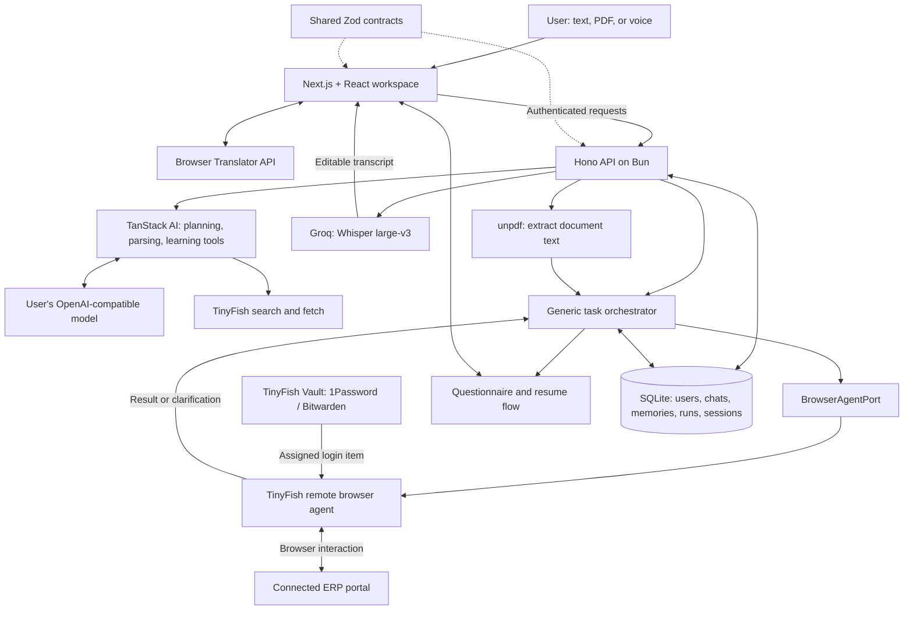

<div align="center">

# ERP Fish

### From a document and a request to work completed in your ERP.

An AI workspace that helps users understand documents, answer operational questions, and carry out ERP tasks through a browser agent.


[Features](#features) · [Architecture](#architecture) · [Tech stack](#tech-stack) · [Setup](#setup-guide) · [Demo walkthrough](#demo-walkthrough) · [Verification](#verification)

</div>

## Why ERP Fish?

ERP work often starts outside the ERP: a supplier quotation, a PDF invoice, a message, or a spreadsheet of instructions. A person then translates that information into forms, searches for existing records, resolves missing details, and repeats the same decisions next time.

ERP Fish brings that workflow into a conversation. Attach a document, describe the task, choose whether to save a draft or submit, and let a TinyFish browser agent work inside the connected ERP. When information is missing, the agent can ask a focused question. Reusable answers can become editable memories for future work.

> **Example:** “Create a purchase order from this supplier quotation. Save it as a draft. Ask me if the warehouse is unclear.”

## Features

| Capability | What it does |
| --- | --- |
| **Planning and Agent modes** | Discuss documents and research in Planning; authorize ERP browser work in Agent mode. |
| **Generic browser workflow** | Discovers the connected ERP's forms and navigation for the requested task, including purchase orders, sales orders, and stock entries. No fixed PO → SO → Stock sequence. |
| **Document attachments** | Accepts readable PDFs, text, and JSON for agent requests. Sent documents appear with the user's message. |
| **Explicit completion policy** | Choose **Save as draft** or **Create and submit** before starting a run. |
| **Questionnaires** | Missing or ambiguous details can pause a task with clickable choices and a custom-answer field. Answering resumes the task. |
| **Reusable memory** | The agent decides whether an answer is worth remembering. Users can inspect, edit, or delete saved memories. |
| **Persistent conversations** | Stores messages, task context, browser attempts, results, questions, and answers. Rename, pin, archive, restore, or delete conversations. |
| **Bring your own LLM** | Save an OpenAI-compatible endpoint, model ID, and API key per account for planning, parsing, and learning continuations. |
| **Research and readable answers** | TinyFish-backed search/fetch tools, activity traces, citations, Markdown rendering, and response-copy controls. |
| **Desktop multilingual experience** | English, Hindi, and Tamil interface; client-side conversation translation with English as the canonical agent/API language. |
| **Voice input** | Groq `whisper-large-v3` puts an editable transcript into the message composer. |
| **Account and connection settings** | Shows the signed-in email, connected ERP URL, model connection, and assigned remote Vault readiness. |
| **Light and dark themes** | Green branding, responsive layouts, and shadcn components throughout the workspace. |

Browser automation depends on the target ERP and the information supplied. The agent searches for existing records before creating new ones, but duplicate prevention and draft behavior are agent-guided—not universal guarantees for every portal. Unconfirmed outcomes require review before another run.

## Architecture



**Provider responsibilities:** the user's model powers planning and document parsing. TinyFish runs the remote ERP browser agent through its own service; changing the BYO model does not replace TinyFish's remote browser engine.

**A task's lifecycle:** request + attachment → draft/submit confirmation → owned ERP/Vault checks → browser execution → question and answer if needed → verified result or explicit review state. Chat-specific profiles and attempt IDs preserve continuity. An uncertain outcome is not automatically retried.

### Repository layout

```text
erp-fish/
├── apps/
│   ├── web/           # Next.js UI, translations, chat, memory, settings
│   └── api/           # Hono routes, auth, orchestrator, tools, SQLite, tests
├── packages/shared/   # Shared Zod schemas, types, constants, demo fixtures
├── infra/
│   ├── erpnext/       # Optional ERPNext demo environment instructions
│   └── tunnel/        # Optional Cloudflare Tunnel setup
├── specs/             # Product, architecture, and agent-flow specifications
└── LOOP_LOG.md        # Verification history and live run evidence
```

## Tech stack

| Layer | Technologies |
| --- | --- |
| Runtime and language | Bun workspaces, TypeScript 6 |
| Web application | Next.js 16 App Router, React 19 |
| UI and styling | shadcn/ui and AI components, Base UI, Tailwind CSS 4, Lucide, `tw-animate-css`, `cmdk`, `cn`, `class-variance-authority` |
| AI and data | TanStack AI, AI React bindings, OpenAI-compatible and Groq adapters, TanStack Query, TanStack Markdown, Shiki |
| Additional installed TanStack packages | React Form, React Table, React Pacer, Charts, React Hotkeys Devtools; these dependencies do not imply that every corresponding product feature is exposed |
| Localization and URL state | next-intl, native browser Translator API, nuqs |
| Backend and contracts | Hono, typed Hono client, Zod, `@hono/zod-validator`, `@t3-oss/env-core`, `@t3-oss/env-nextjs` |
| Remote automation and credentials | `@tiny-fish/sdk`, TinyFish browser profiles and Vault, connected 1Password or Bitwarden |
| Speech and documents | Groq `whisper-large-v3`, browser recording APIs, unpdf |
| Storage, auth, logging | Bun SQLite, password hashing through Bun, JWT session cookies, AES-GCM encryption for saved model keys, Pino |
| Quality tooling | Bun tests, TypeScript, ESLint, typescript-eslint, Next/React lint rules, shadcn lint, llm-core lint, React Doctor |
| Optional ERP demo infrastructure | ERPNext and Cloudflare Tunnel; see the guides in `infra/` |

The manifests and `bun.lock` are the source of truth for installed versions. `main` currently uses remote TinyFish execution. The local Chromium/Docker application work is developed separately on `feature/local-browser` and is not part of this setup.

## Setup guide

### 1. Prerequisites

- Git and Bun 1.4.x (the web package declares Bun 1.4.3).
- Node.js 20.9+ for Next.js tooling; a supported Node LTS is recommended.
- An OpenAI-compatible model with tool calling and JSON output for AI planning/parsing. DeepSeek through a compatible endpoint is one possible configuration.
- For live Agent mode: a TinyFish API key, connected TinyFish Vault login, and an ERP reachable by the remote browser over public HTTPS.
- Optional: a Groq API key for voice input.
- Desktop browser translation requires native Translator API support **and** available language pairs. English remains usable when translation is unavailable.

### 2. Clone and install

```bash
git clone https://github.com/Arjunsharmahehe/erp-fish.git
cd erp-fish
git switch main
bun install --frozen-lockfile
```

Copy the environment templates:

```bash
# macOS / Linux
cp apps/api/.env.example apps/api/.env.local
cp apps/web/.env.example apps/web/.env.local
```

```powershell
# Windows PowerShell
Copy-Item apps/api/.env.example apps/api/.env.local
Copy-Item apps/web/.env.example apps/web/.env.local
```

### 3. Configure the API and frontend

Generate a session/encryption secret locally:

```bash
bun -e 'console.log(require("node:crypto").randomBytes(48).toString("base64"))'
```

Set these values in `apps/api/.env.local`:

```dotenv
PORT=3001
CORS_ORIGIN=http://localhost:3000
DB_PATH=erp-fish.db
DEMO_AGENT=false
JWT_SECRET=replace-with-the-generated-secret

# Required for remote browser tasks and search/fetch tools:
TINYFISH_API_KEY=replace-with-your-tinyfish-key

# Optional server-wide model defaults; personal Settings override these:
# OPENAI_BASE_URL=https://your-provider.example/v1
# OPENAI_MODEL=your-model-id
# OPENAI_API_KEY=your-model-key

# Optional voice input:
# GROQ_API_KEY=your-groq-key
```

In `apps/web/.env.local`:

```dotenv
NEXT_PUBLIC_API_URL=http://localhost:3001
```

Keep real keys in local environment files. Preserve `JWT_SECRET` alongside database backups: saved model API keys are encrypted using a key derived from it, and changing it invalidates sessions and the ability to decrypt those keys.

### 4. Start both services

Run each command in a separate terminal from the repository root:

```bash
# Terminal 1: API
bun run --filter api dev
```

```bash
# Terminal 2: frontend
bun run --filter web dev --port 3000
```

Open **http://localhost:3000**. The API health route is **http://localhost:3001/api/hello**. SQLite tables are initialized by the API; no separate database server or migration CLI is required for this setup.

Sign up, open **Settings**, and save the ERP URL. Under **AI model**, enter the completion/base URL, model ID, and API key if server defaults are not configured. This branch requires public HTTPS model endpoints; private-network URLs and redirects are rejected.

### 5. Connect TinyFish Vault for Agent mode

1. In the [TinyFish dashboard](https://agent.tinyfish.ai/), connect a supported 1Password or Bitwarden vault containing the ERP login.
2. Ensure the login item includes the connected ERP domain. Obtain its TinyFish credential item ID.
3. Sign up for ERP Fish and obtain that account's immutable user UUID from the authenticated `GET /api/auth/me` response (`user.id`). You can inspect it in browser DevTools → Network while signed in.
4. As the server owner, assign that UUID and the **exact normalized ERP URL saved in Settings** to the item in `apps/api/.env.local`:

```dotenv
TINYFISH_VAULT_BINDINGS='[{"user_id":"00000000-0000-4000-8000-000000000001","erp_url":"https://erp.example.com","credential_item_id":"cred:connection:vault:item"}]'
```

5. Replace every placeholder, restart the API, then refresh the Vault status in Settings.
6. Select **Agent** in the composer and start a task once the connection is ready.

The remote adapter sends `use_vault: true`, `use_profile: true`, and the assigned credential reference. Passwords are not placed in the agent prompt. Bindings use approved user UUIDs, not email addresses; signup does not verify email ownership. Saving credentials in the retained local encrypted store does not configure TinyFish Vault.

### 6. Enable languages and voice

- Use the topbar language selector on the landing page or dashboard for **English**, **Hindi**, or **Tamil**.
- One preference controls interface, transcript, and response language. Prepare/download browser language packs when prompted.
- Add `GROQ_API_KEY` and restart the API to use the green microphone. Stop recording, edit the transcript in the composer, then send.
- Recordings are limited to two minutes and 10 MB. Microphone permission requires localhost or HTTPS.
- User text is displayed in its original language. Canonical chat/tool/memory content stays English; conversation translation runs in the browser. Links, code, identifiers, numbers, and known ERP labels are protected. Use backticks around exact ERP names.
- Language and voice controls are hidden below 768 px. Unsupported browsers can use English; there is no cloud translation fallback.

### Environment reference

| Variable | Purpose |
| --- | --- |
| `JWT_SECRET` | Required at API startup; stable session and model-key encryption secret |
| `PORT`, `CORS_ORIGIN` | API listening port and allowed frontend origin; defaults 3001 and `http://localhost:3000` |
| `DB_PATH` | SQLite path; default `erp-fish.db`, relative to the API process working directory |
| `TINYFISH_API_KEY` | Remote Agent mode and planning search/fetch |
| `TINYFISH_VAULT_BINDINGS` | Server-owned per-user/per-ERP credential assignments; restart after changes |
| `OPENAI_BASE_URL`, `OPENAI_MODEL`, `OPENAI_API_KEY` | Optional default model connection; configure all three together |
| `GROQ_API_KEY` | Optional speech-to-text provider key |
| `JWT_TTL_SECONDS` | Session duration; default 604800 seconds |
| `NODE_ENV` | `development`, `test`, or `production`; production session cookies require HTTPS |
| `ERP_CREDENTIALS_KEY` | Optional base64 32-byte key for the retained local credential store; not used for remote Vault login |
| `NEXT_PUBLIC_API_URL` | Required frontend API origin; rebuild the frontend after changing it in a production build |
| `DEMO_AGENT` | Legacy fixture behavior only; it does not enable fake results in live chat Agent mode |
| `ERP_BASE_URL`, `TUNNEL_PROFILE_ID`, `MOCK_ERP_URL`, `NEXT_PUBLIC_ERP_HOST`, `NEXT_PUBLIC_PROFILE_ID` | Legacy/demo adapter settings; the generic chat agent uses the account's connected ERP and per-chat profile |

### Production build / recording mode

Build and run the frontend:

```bash
cd apps/web
bun run build
bun run start --port 3000
```

Run the API separately:

```bash
cd apps/api
bun --env-file=.env.local src/index.ts
```

For an HTTP localhost recording, keep the API in development mode. For deployment, configure `NODE_ENV=production` on the API, HTTPS for both services, the correct `CORS_ORIGIN` and API URL, persistent SQLite storage, and stable secrets. The frontend and API are separate services.

### Optional: your own demo ERP

Use a hosted test ERP or follow [the ERPNext guide](infra/erpnext/README.md) and [Cloudflare Tunnel guide](infra/tunnel/README.md). TinyFish must be able to reach the ERP; a localhost-only URL is not reachable from its remote browser. Keep the public URL stable for Vault matching and browser-profile continuity. The infrastructure guides contain their own verification caveats.

## Demo walkthrough

1. Show the landing page, theme switch, and desktop language selector.
2. Sign in and show the connected ERP, model settings, and ready Vault status.
3. In Planning mode, attach a document and ask for a summary or missing details.
4. Switch to Agent mode, attach the quotation, and request a purchase order.
5. Choose **Save as draft**. If asked, select a warehouse or enter a custom answer.
6. Show the returned record ID and verify the draft in the ERP.
7. Show the Memory page and explain how reusable answers can reduce future questions.
8. Repeat the same request to demonstrate the agent checking for the existing record.

Use a test ERP and sample documents for rehearsal. A memory is created only when the agent decides an answer is reusable; it is not guaranteed after every question.

## Verification

```bash
bun run typecheck
bun run lint
bun run check
bun test apps/api/tests
```

For frontend changes:

```bash
cd apps/web
bunx react-doctor@latest --verbose
```

See [LOOP_LOG.md](LOOP_LOG.md) for recorded checks and live browser run IDs. The current [generic agent specification](specs/06-generic-agent-phase1.md) describes the implemented flow and its limitations; earlier specs also describe historical fixture workflows. A live PO creation/replay was verified against the demo ERP, including return of the same existing ID. This does not establish compatibility with every ERP.

## Troubleshooting

| Symptom | Check |
| --- | --- |
| “Service unavailable” during login | API process is running; `JWT_SECRET` is set; frontend API URL and CORS origin match your ports. |
| “Vault setup needed” | Correct TinyFish key, connected Vault item, approved user UUID, exact saved ERP URL, matching item domain, and API restarted after binding changes. |
| Model request fails | Public HTTPS endpoint, correct model/key, tool-calling and JSON-output support. Personal settings take precedence over environment defaults. |
| PDF cannot be read | Use a PDF with a text layer or provide text/JSON. Scanned-image OCR is not included. |
| Translation unavailable | Check browser Translator API and language-pair support; complete pack preparation or continue in English. |
| Microphone unavailable | Configure Groq, restart API, grant microphone permission, and use localhost or HTTPS. |
| Chat is blocked after a browser failure | Inspect the ERP for saved changes and confirm the remote run has stopped, then use the run's review controls. Do not blindly create another copy. |
| A remote browser cannot open the ERP | Confirm public HTTPS reachability, the URL in Settings, and the Vault domain assignment. |

## Project notes

- **Data boundaries:** documents and page content needed for execution reach TinyFish; planning/parsing content reaches the configured model provider; audio reaches Groq. Conversation translation stays in the browser.
- **Memory scope:** saved answers are scoped to the user and ERP. Users can edit or delete them; the agent chooses what to retain.
- **Persistence:** back up the SQLite database and relevant stable encryption secrets together. Keep environment files and credentials out of Git.

Built with TinyFish for browser-based ERP work, with a composable browser adapter boundary for future execution providers.
